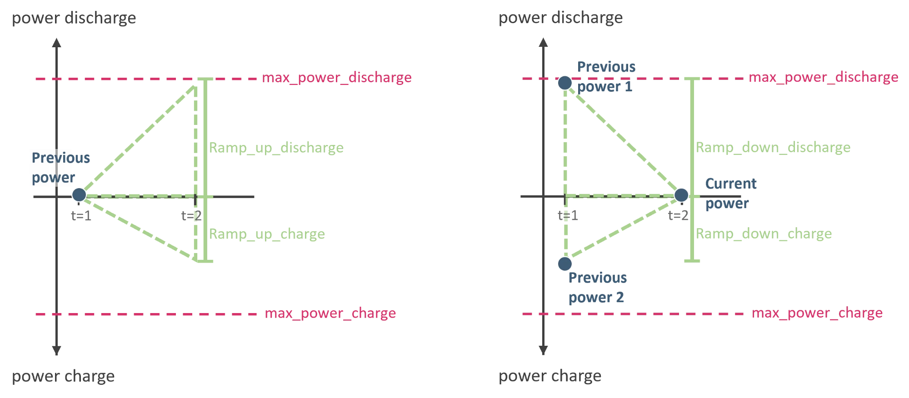
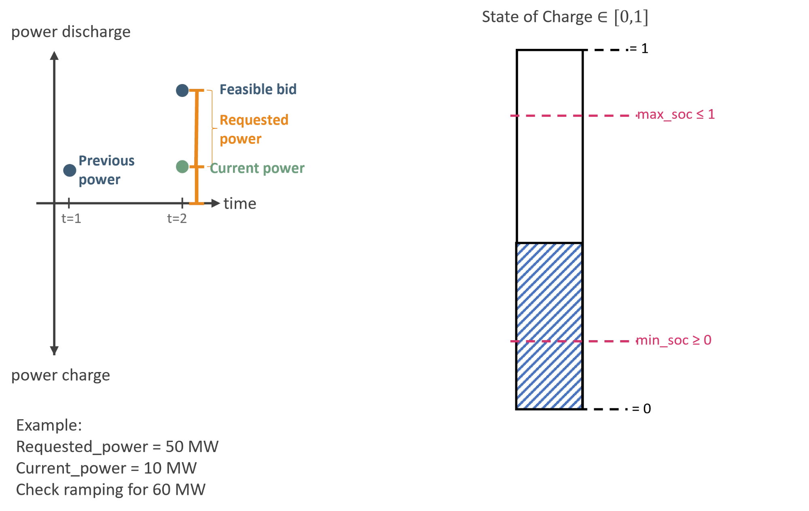
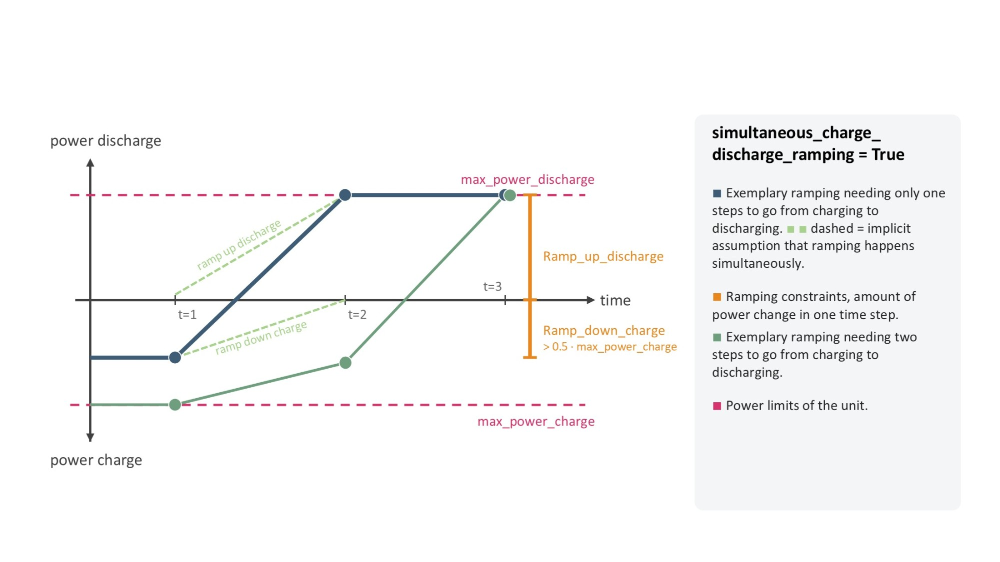
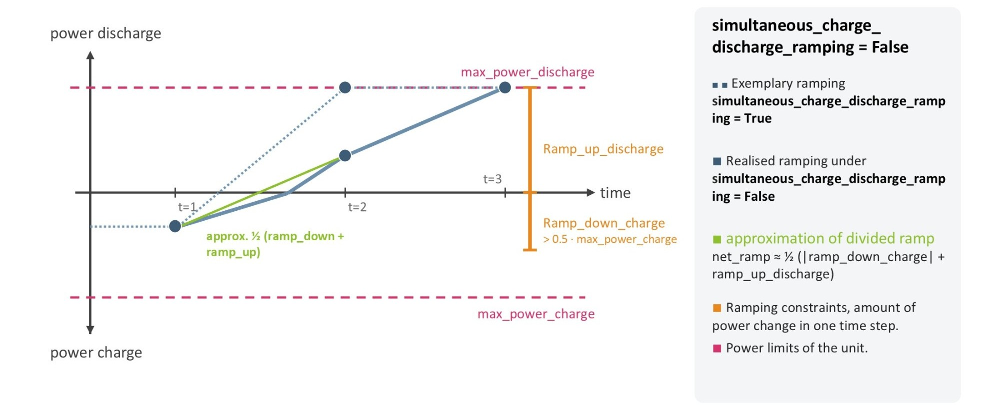
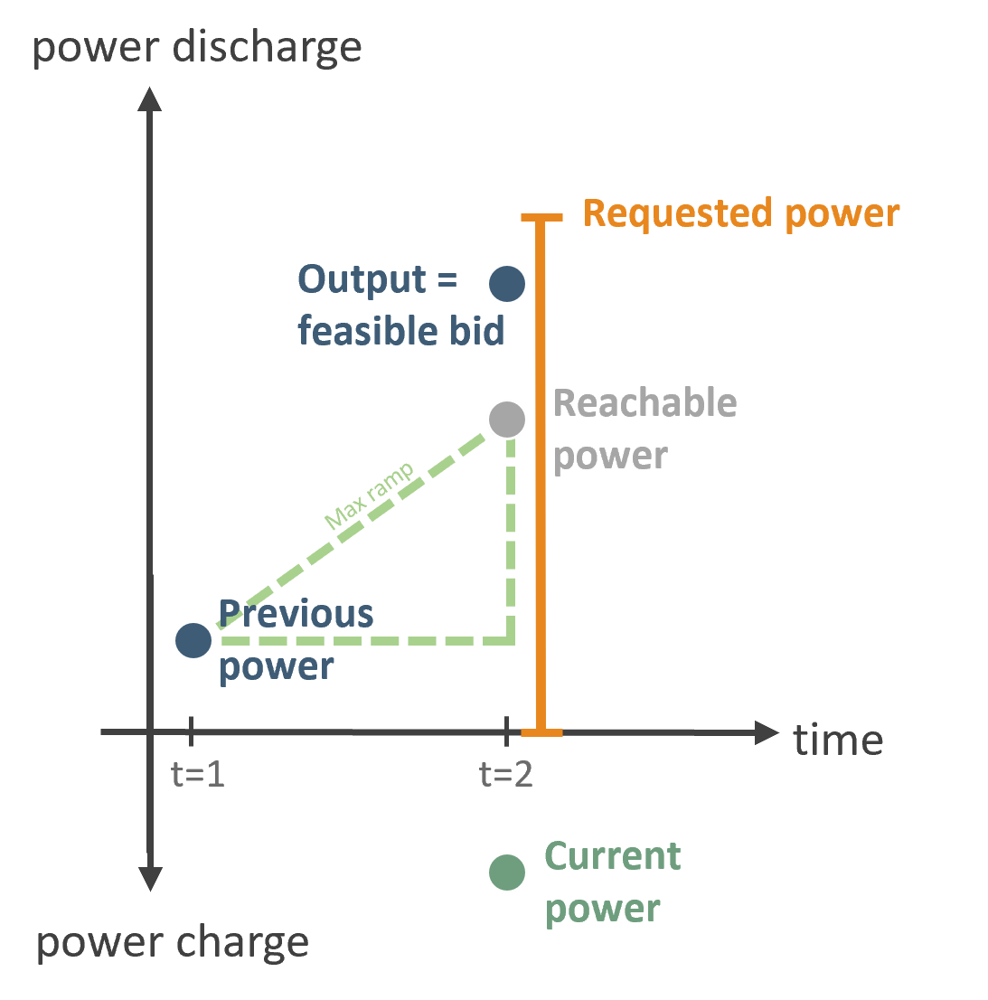

.. SPDX-FileCopyrightText: ASSUME Developers
..
.. SPDX-License-Identifier: MIT

Storage Units
=============

The :class:`~assume.units.storage.Storage` unit (and more generally any unit built on :class:`~assume.common.base.SupportsMinMaxCharge`, e.g. storage components used inside demand-side
units) models a device that can both consume power from the grid (**charging**) and feed power back into the grid (**discharging**).

General Definitions
-------------------

This pages defines the parameterisation and explains how different limits change storage behavior.
Throughout the code and this page, the same sign convention is used everywhere:

- **Discharging power is positive.** It is bounded between ``min_power_discharge`` and
  ``max_power_discharge`` (both ``>= 0``).
- **Charging power is negative.** It is bounded between ``max_power_charge`` and
  ``min_power_charge`` (both ``<= 0``, with ``max_power_charge <= min_power_charge``, i.e.
  ``max_power_charge`` is the most negative / largest-magnitude charging power).
- A power of ``0`` means the unit is idle.

The usable energy content of the storage is tracked as a **state of charge (SOC)**, a value between 0 and 1 relative to the unit's ``capacity`` in MWh. The SOC of a time step is the value at its beginning, before the dispatch of that step: an SOC of 0.5 at 22:00 means that half of the capacity is stored at 22:00, and the dispatch from 22:00 to 23:00 changes the SOC of 23:00.
The SOC is kept within ``min_soc`` and ``max_soc``. How far the unit can charge or discharge in the current step is additionally capped by how much energy is actually left in (or missing from) the storage -- this is computed by :meth:`~assume.units.storage.Storage.calculate_soc_max_charge` and :meth:`~assume.units.storage.Storage.calculate_soc_max_discharge`.

On top of the SOC-based limits, the unit has **ramping constraints** that limit how much the power
output is allowed to change from one time step to the next:

- ``ramp_up_discharge`` / ``ramp_down_discharge`` (both ``>= 0``): the maximum increase/decrease of   the discharging power per time step.
- ``ramp_up_charge`` / ``ramp_down_charge`` (both ``<= 0``): the maximum increase/decrease of the charging power per time step (recall that charging power is negative, so "ramping up the charge"
  means becoming more negative).

The figure below illustrates these four quantities as the maximum reach of a single time step. On the left, a unit starting from the same ``previous_power`` can ramp up towards discharging or towards charging within one step -- ``ramp_up_discharge`` and ``ramp_up_charge`` are the two (independent) distances it can cover in either direction. On the right, two different starting points (one already discharging near its maximum, one already charging near its maximum) both ramp *down* towards the same ``current_power`` -- ``ramp_down_discharge`` and ``ramp_down_charge`` are how far each of them can move towards that point within one step.

Because a unit can be active on several markets in the same time step, every ramping check distinguishes between three power values:

- **Previous power**: the power the unit was dispatched at in the *previous* time step (``previous_power``).
- **Current power**: the power already committed/sold on *other* markets for the *same* time step (``current_power``).
- **Requested power**: the bid being checked for a *new* market product (``requested_power_discharge``   / ``requested_power_charge``). This always answers the question "what do I want to offer on *this*   market right now?" -- it is a standalone power level for this one market, **not** a delta relative to ``current_power`` and **not** the combined total across all markets.

Ramping (and the SOC limit) are always checked on the *combination* of ``current_power`` and the requested power, because that combination is what the unit physically has to deliver. The function then returns the **feasible bid**: the largest/smallest power level for *this* market that keeps ``current_power + feasible_bid`` within what the unit can actually ramp to and what the SOC can back. That feasible bid is, again, a value for this one market -- ``current_power`` is only used internally to net the check, it is never added into the returned number.

Example (as shown above): with ``requested_power = 50 MW`` for this market and ``current_power = 10 MW`` already committed on another market, the ramping constraint is checked for a combined power level of 60 MW, i.e. ``requested_power + current_power`` -- but the function still only returns the feasible value for *this* market's bid, not the combined 60 MW.

Ramping Behaviour
------------------

Ramping is evaluated by
:meth:`~assume.units.storage.Storage.calculate_ramp_discharge` /
:meth:`~assume.units.storage.Storage.calculate_ramp_charge`
(building on the generic implementation in
:class:`~assume.common.base.SupportsMinMaxCharge`). Both methods take ``previous_power``, ``requested_power`` and ``current_power`` and return the power level that is actually feasible given the ramping constraints.

If the unit was charging in the previous step and now requests to discharge (or vice versa), the first question is always whether the unit can even ramp back through zero within one time step -- if ``previous_power`` cannot reach 0 given ``ramp_down_charge`` (or ``ramp_down_discharge``), the requested direction switch is infeasible and no power in that direction can be offered. However, power already committed on another market counts towards this: with ``previous_power = -60`` and ``ramp_down_charge = -50`` the unit can charge a minimum of10 MW, so with ``current_power = -20`` a discharge bid of up to 10 MW is feasible (total -10 MW).

If a switch through zero is feasible, there are two different ways to model what happens *within* that one time step, controlled by the ``simultaneous_charge_discharge_ramping`` flag:

``simultaneous_charge_discharge_ramping = True``
^^^^^^^^^^^^^^^^^^^^^^^^^^^^^^^^^^^^^^^^^^^^^^^^^

The unit is assumed to be able to ramp down the charging power and ramp up the discharging power *simultaneously* within the same time step -- physically this corresponds to separate
turbines/pumps (or separate charge/discharge paths) that can act independently of one another. A full switch from charging to discharging therefore only needs **one** time step, and the full ``ramp_up_discharge`` (or ``ramp_up_charge``) is available on top of ramping the previous direction down to zero.

``simultaneous_charge_discharge_ramping = False``
^^^^^^^^^^^^^^^^^^^^^^^^^^^^^^^^^^^^^^^^^^^^^^^^^

The unit cannot ramp charging and discharging at the same time -- there is only a single physical ramp that first has to bring the power to zero before the opposite direction can be ramped up. A full switch from ``max_power_charge`` to ``max_power_discharge`` (or back) therefore generally needs **two** time steps for the full switch.
To still allow a (partial) sign switch within a single time step without letting the unit ramp roughly twice its single-direction ramp limit, the net ramp available for the switch is approximated as the average of the two ramps involved.

The blue dashed line in the figure shows the (infeasible) outcome if ramping were allowed simultaneously; the solid blue line shows what is actually reachable when ``simultaneous_charge_discharge_ramping = False``, and the green line shows the ``net_ramp`` approximation used to limit it.

.. note::

   Independent of ``simultaneous_charge_discharge_ramping``, the SOC-based limits    (:meth:`~assume.units.storage.Storage.calculate_soc_max_charge` /
   :meth:`~assume.units.storage.Storage.calculate_soc_max_discharge`) are always applied *on top of* the ramping result, and ``min_power_charge`` / ``min_power_discharge`` can clip the result back to zero if the ramp- and SOC-feasible power falls below the minimum operating power.

Multi-Market Ramping and Reachable Power
------------------------------------------

Since ``current_power`` (power already committed on another market in the same time step) is part of every ramping check, a unit can offer power on a new market even if, in isolation, that power level looks like it violates the ramp -- as long as the *combined* dispatch stays within what is physically reachable from ``previous_power``.

In the figure, "Reachable power" is the physical ramp limit from ``previous_power`` alone (``previous_power + ramp_up_discharge``), ignoring any other market. "Requested power" is what gets checked and returned for *this* market and it can sit *above* "Reachable power", because "Current power" (already committed, and charging here, so negative) is netted into the check. As long as ``current_power + feasible_bid`` stays at or below "Reachable power", the bid itself is allowed to be larger than what the ramp alone would suggest.

Example: a unit with ``ramp_up_discharge = 40`` and a previous power of ``previous_power = 10`` MW already charges ``current_power = -20`` MW on another market. "Reachable power" is ``10 + 40 = 50`` MW. Even though a new market requests more than that (``requested_power_discharge = 90``), the unit can still offer 70 MW on it:

.. code-block:: python

    unit.calculate_ramp_discharge(
        previous_power=10,
        requested_power_discharge=90,
        current_power=-20,
    ) == 70

The feasible discharge bid is 70 MW. This is the previous power plus the full ``ramp_up_discharge``, net of the ``current_power`` already committed elsewhere (``10 + 40 - (-20) = 70``), i.e. 20 MW above "Reachable power". Combined with the -20 MW charged on the other market, the resulting net output of 50 MW matches "Reachable power" exactly, as it must: that combined total is what is actually physically delivered and is the quantity the ramp constraint really limits.
