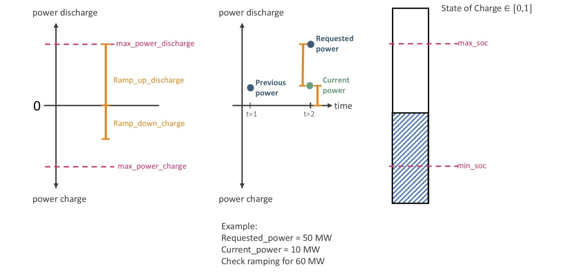
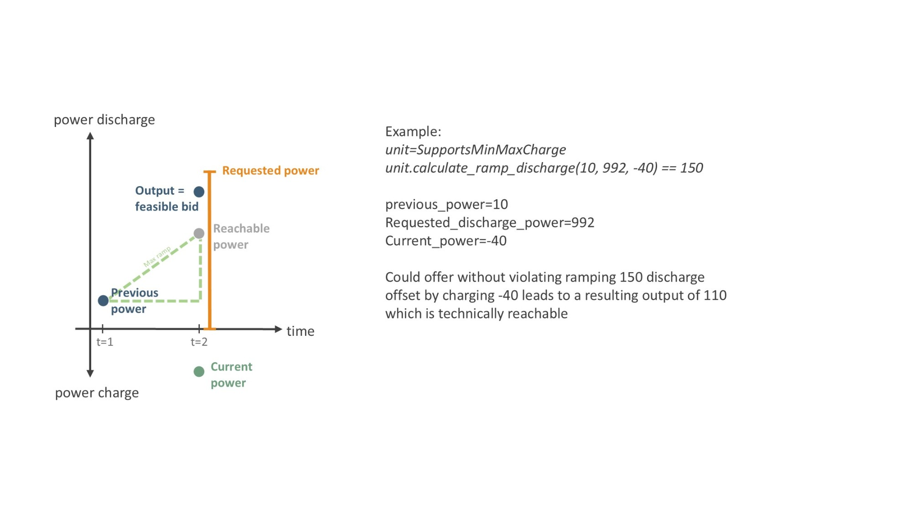

.. SPDX-FileCopyrightText: ASSUME Developers
..
.. SPDX-License-Identifier: MIT

Storage Units
=============

The :class:`~assume.units.storage.Storage` unit (and more generally any unit built on :class:`~assume.common.base.SupportsMinMaxCharge`, e.g. storage components used inside demand-side
units) models a device that can both consume power from the grid (**charging**) and feed power back into the grid (**discharging**).

General Definitions
-------------------

This pages defines the parameterisation and explains how different limits change storage behavior.
Throughout the code and this page, the same sign convention is used everywhere:

- **Discharging power is positive.** It is bounded between ``min_power_discharge`` and
  ``max_power_discharge`` (both ``>= 0``).
- **Charging power is negative.** It is bounded between ``max_power_charge`` and
  ``min_power_charge`` (both ``<= 0``, with ``max_power_charge <= min_power_charge``, i.e.
  ``max_power_charge`` is the most negative / largest-magnitude charging power).
- A power of ``0`` means the unit is idle.

The usable energy content of the storage is tracked as a **state of charge (SOC)**, a value between 0 and 1 relative to the unit's ``capacity`` in MWh. It is kept within ``min_soc`` and ``max_soc``. How far the unit can charge or discharge in the current step is additionally capped by how much energy is actually left in (or missing from) the storage -- this is computed by :meth:`~assume.units.storage.Storage.calculate_soc_max_charge` and :meth:`~assume.units.storage.Storage.calculate_soc_max_discharge`.

On top of the SOC-based limits, the unit has **ramping constraints** that limit how much the power
output is allowed to change from one time step to the next:

- ``ramp_up_discharge`` / ``ramp_down_discharge`` (both ``>= 0``): the maximum increase/decrease of   the discharging power per time step.
- ``ramp_up_charge`` / ``ramp_down_charge`` (both ``<= 0``): the maximum increase/decrease of the charging power per time step (recall that charging power is negative, so "ramping up the charge"
  means becoming more negative).

Because a unit can be active on several markets in the same time step, the ramping check always distinguishes between three power values:

- **Previous power**: the power the unit was dispatched at in the *previous* time step   (``previous_power``).
- **Current power**: the power already committed/sold on *other* markets for the *same* time step   (``current_power``).
- **Requested power**: the power level a new market product is being checked for (``requested_power_discharge`` / ``requested_power_charge``). This is an absolute power level defined from zero (not a delta between current or previous power) and its sign indicates the direction (discharging or charging).

Example (as shown above): with ``Requested_power = 50 MW`` and ``Current_power = 10 MW`` already
committed on another market, the ramping constraint is checked for a **total** power level of 60 MW,
i.e. ``requested_power + current_power``.

Ramping Behaviour
------------------

Ramping is evaluated by
:meth:`~assume.units.storage.Storage.calculate_ramp_discharge` /
:meth:`~assume.units.storage.Storage.calculate_ramp_charge`
(building on the generic implementation in
:class:`~assume.common.base.SupportsMinMaxCharge`). Both methods take ``previous_power``, ``requested_power`` and ``current_power`` and return the power level that is actually feasible given the ramping constraints.

If the unit was charging in the previous step and now requests to discharge (or vice versa), the first question is always whether the unit can even ramp back through zero within one time step -- if ``previous_power`` cannot reach 0 given ``ramp_down_charge`` (or ``ramp_down_discharge``), the requested direction switch is infeasible and no power in that direction can be offered.

If a switch through zero is feasible, there are two different ways to model what happens *within* that one time step, controlled by the ``simultaneous_charge_discharge_ramping`` flag:

``simultaneous_charge_discharge_ramping = True``
^^^^^^^^^^^^^^^^^^^^^^^^^^^^^^^^^^^^^^^^^^^^^^^^^

The unit is assumed to be able to ramp down the charging power and ramp up the discharging power *simultaneously* within the same time step -- physically this corresponds to separate
turbines/pumps (or separate charge/discharge paths) that can act independently of one another. A full switch from charging to discharging therefore only needs **one** time step, and the full ``ramp_up_discharge`` (or ``ramp_up_charge``) is available on top of ramping the previous direction down to zero.

.. image:: img/Storage_Ramping_FullSwitch.jpg
    :align: center
    :width: 700px

``simultaneous_charge_discharge_ramping = False``
^^^^^^^^^^^^^^^^^^^^^^^^^^^^^^^^^^^^^^^^^^^^^^^^^

The unit cannot ramp charging and discharging at the same time -- there is only a single physical ramp that first has to bring the power to zero before the opposite direction can be ramped up. A full switch from ``max_power_charge`` to ``max_power_discharge`` (or back) therefore generally needs **two** time steps for the full switch.
To still allow a (partial) sign switch within a single time step without letting the unit ramp roughly twice its single-direction ramp limit, the net ramp available for the switch is approximated as the average of the two ramps involved.

.. image:: img/Storage_Ramping_PartialSwitch.jpg
    :align: center
    :width: 700px

The blue dashed line in the figure shows the (infeasible) outcome if ramping were allowed simultaneously; the solid blue line shows what is actually reachable when ``simultaneous_charge_discharge_ramping = False``, and the green line shows the ``net_ramp`` approximation used to limit it.

.. note::

   Independent of ``simultaneous_charge_discharge_ramping``, the SOC-based limits    (:meth:`~assume.units.storage.Storage.calculate_soc_max_charge` /
   :meth:`~assume.units.storage.Storage.calculate_soc_max_discharge`) are always applied *on top of* the ramping result, and ``min_power_charge`` / ``min_power_discharge`` can clip the result back to zero if the ramp- and SOC-feasible power falls below the minimum operating power.

Multi-Market Ramping and Reachable Power
------------------------------------------

Since ``current_power`` (power already committed on another market in the same time step) is part of every ramping check, a unit can offer power on a new market even if, in isolation, that power level looks like it violates the ramp -- as long as the *combined* dispatch stays within what is physically reachable from ``previous_power``.

Example: a unit with ``simultaneous_charge_discharge_ramping = True``, ``ramp_up_discharge = 100`` and a previous power of ``previous_power = 10`` MW already charges ``current_power = -40`` MW on another market. Even though a new market requests far more than the ramp could ever deliver (``requested_power_discharge = 160``), the unit can still offer the amount of discharge that, *combined* with the -40 MW it already charges, stays within the reachable power:

.. code-block:: python

    unit.calculate_ramp_discharge(
        previous_power=10,
        requested_power_discharge=160,
        current_power=-40,
    ) == 150

The feasible discharge bid is 150 MW -- the previous power plus the full ``ramp_up_discharge``, net of the ``current_power`` already committed elsewhere (``10 + 100 - (-40) = 150``). Combined with the -40 MW charged on the other market, the resulting net output of 110 MW is exactly the "Reachable power" shown above.
